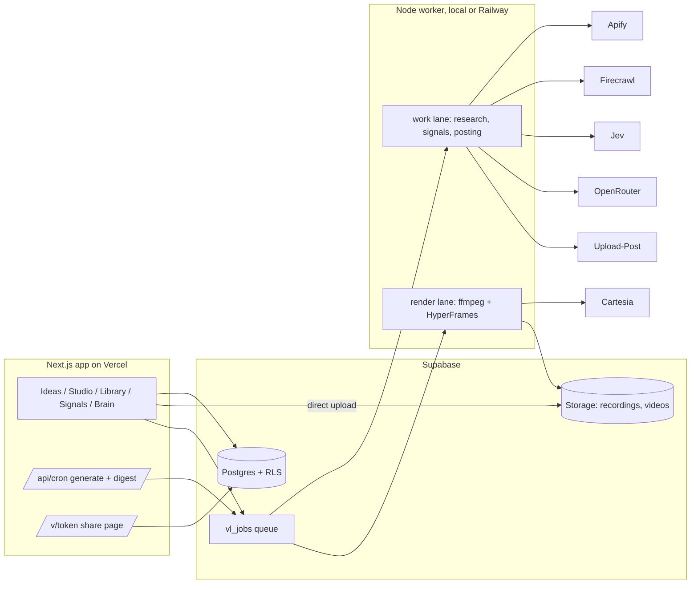
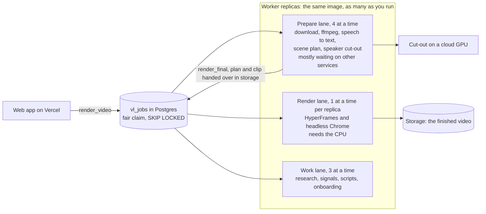

# Verbalore

A daily video plan for people who know they should be on camera and never find the time.

Verbalore researches what your market is posting about, writes the script in your voice, prompts you while you record, and edits the video for you with a graphic on every scene. A second half of the product watches the accounts in your CRM and turns each buying signal into a personal video note.

| | |
|---|---|
| Track | _Antler Agents |
| Demo video (Loom) | https://www.loom.com/share/72327614371f46ac81bfec2d437426f8 |
| Deployed URL | https://verbalore.vercel.app |
| Team | Wali Ullah Khan | wali@wallai.org | https://linkedin.com/in/waliullah-khan |

## What it does

1. **Ideas.** Seven use-case tabs (real estate, software developers, product marketers, GTM executives, C-suite, founders, general). Each pulls what people are posting in that niche from Reddit, Hacker News, YouTube, TikTok, Instagram, LinkedIn and Facebook, scores every post against others on its own platform, drops off-topic ones, and writes five ideas. Each idea shows its evidence, one reference post picked by Jev with its hook / body / ending broken down, and a script in your voice.
2. **Daily email.** A cron job queues the research each morning and a second one emails the five best ideas. Each has a button that opens the teleprompter.
3. **Studio.** Camera preview, scrolling teleprompter (speed, size, mirror, pause on space), retake as often as you like, direct upload to storage. You can also upload an existing video.
   **Record on your phone:** the Studio shows a QR code. Scan it and the phone opens a full-screen recorder with the same teleprompter, no sign-in needed. When you press send, the take uploads straight to storage and appears in the desktop Studio on its own, ready to edit. The link is single-purpose, expires after two hours, and can only upload into its own folder.
4. **Edit.** A worker normalises the take, gets word timings, cuts the transcript into scenes, and gives every scene a graphic: hook title, stat, list, quote, tip, code window, before/after, fact tiles, call to action. The scene plan is validated, so a scene can never ship without its graphic. Each use case offers its own edit themes (editorial, kinetic type, product UI, listing, terminal, boardroom).
5. **Library and posting.** Preview, re-edit in another style, and post to up to 15 platforms through Upload-Post, now or scheduled.
6. **Signals.** Watch any organization: add one, or paste a list of names and websites. For each one the engine reads the primary sources directly (SEC filings, the company's job board, its own website, GitHub) and also searches the news. Results are classified, de-duplicated, and ranked by fit and urgency, and each shows where it was found. You can also add a plain-language signal to watch ("opened a new office"). Pick a signal and a contact and it writes a 30 second note, you record it, and it goes out as a share page `/v/<token>` with view tracking.
7. **Brain.** Notes, posts and pages you add. Scripts are written only from this, and a voice profile (tone, sentence length, repeated phrases) is learned from your own writing. A document can apply to everything or to one use-case tab, so real-estate notes never leak into developer content.

## Where signals come from

| Source | What it reads | Why it can be early |
|---|---|---|
| SEC EDGAR | Form D (a private company reporting a raise), S-1, 8-K, matched on the filer's own name | A Form D is filed within days of the first sale, often before any announcement |
| Job boards | The company's Greenhouse, Ashby, Lever, Workable or Recruitee board, read through the public API, with the publish date of each role | The board is the source of truth and is updated before the careers page or LinkedIn. Roles missing from the careers page are flagged |
| Company website | Pricing page, homepage and blog, compared with the last scan | Changes appear on the site before they are written about |
| GitHub | New public repositories under the company's own organization | Engineering ships before marketing announces |
| City permits (Austin) | The City of Austin's issued-permit records on its open data portal, updated daily: new homes by ZIP, teardowns, large projects with the builder and a link to the permit, and the most active builders | A permit is issued months before a listing, a sale or a news story |
| News and social | Web search | Reported by someone else, so it is the slowest |

**Watching a place.** For real estate you watch a city instead of a company. Austin is wired: "Watch a place" reads the permit records, turns a month's activity into signals (for example "300 new-home permits in 30 days, up 22% on the month before", or a 176-unit project with its builder), and feeds the same facts to the Real estate ideas so scripts quote real local numbers. A permit signal becomes a video script in one click, and a builder named in a permit can be watched like any other organization.

Each source fails on its own without taking the others down, and a signal is only ever created from something the source actually returned. Job boards are found by asking the applicant systems directly. A guessed board is accepted only when the system names the same company, or the company's own site links to it, because two companies can share a name.

## Quick start

Needs Node 22+, ffmpeg and ffprobe on your PATH, and Chrome (HyperFrames renders with it).

```bash
git clone <this repo> && cd verbalore
npm install
cp .env.example .env.local        # then fill it in, see below
# apply supabase/migrations/*.sql in order to a Supabase project
npx tsx --env-file=.env.local scripts/seed-demo.ts

npm run dev                       # the app on http://localhost:3000
npm run worker                    # in a second terminal: research, renders, posting
```

Open http://localhost:3000, press **Open the demo workspace**, and the seeded workspace loads.

Other commands: `npm test`, `npm run typecheck`, `npm run lint`, `npm run scan:secrets` (fails if a key or `.env` file is about to be committed), `npm run check:keys` (read-only check that each configured provider key is accepted; prints status codes, never values).

### Recording from a phone

A phone cannot open `localhost`, so the QR code points at your computer's address on the local network, and the phone must be on the same Wi-Fi (some campus and guest networks isolate devices and block this). Mobile browsers also only allow the live camera on `https`. Over plain `http` the phone page still works: it shows the script and opens the phone's own camera app to record, then uploads as usual. For the live teleprompter on a phone, use the deployed `https` URL, or set `PUBLIC_BASE_URL` to a tunnel address before opening the Studio.

## Deploy

Two pieces, because rendering needs ffmpeg and Chrome, which a serverless function cannot run.

| Piece | Where | What it does |
|---|---|---|
| Web app | Vercel (Next.js) | Pages, sign-in, queuing work, the phone recorder, the share page, the two daily cron routes |
| Worker | Railway (Docker, `Dockerfile.worker`) | Research, signals, scene planning, rendering and posting |

They share one Supabase project and talk only through the `vl_jobs` table.

1. **Supabase.** Apply `supabase/migrations` in order and create the demo user (see below).
2. **Vercel.** Import the repo as a Next.js project. Set the web app's variables: the three Supabase values, `DEMO_USER_EMAIL`, `DEMO_USER_PASSWORD`, `CRON_SECRET`, `OPENROUTER_API_KEY`, `FIRECRAWL_API_KEY`, `RESEND_API_KEY`, `UPLOAD_POST_API_KEY`, and `NEXT_PUBLIC_APP_URL` set to the deployed address. `vercel.json` schedules the two crons; Vercel sends `CRON_SECRET` as the bearer token.
3. **Railway.** Create a service from the repo with `railway.toml` (it builds `Dockerfile.worker`). Set the worker's variables: the Supabase values, every provider key, `NEXT_PUBLIC_APP_URL`, and `JOB_LIMIT_PER_HOUR`.
4. **Supabase Auth.** Add the deployed address to the allowed redirect URLs if you want email sign-in. The one-click demo does not need it.

**A public demo is open to anyone**, so it ships with safeguards: demo workspaces never send real email or post to real accounts unless `ALLOW_DEMO_EMAIL` or `ALLOW_DEMO_PUBLISH` is `true`; the worker runs at most `JOB_LIMIT_PER_HOUR` costly jobs per workspace an hour; the model-calling actions are capped at `DEMO_HOURLY_CAP` an hour; and the Brain only fetches public web pages. Turn on Vercel's deployment protection if you do not want the demo public at all.

## Accounts, onboarding and the video allowance

Anyone can sign up at `/login?mode=signup` with a name, email, LinkedIn profile and password. The account and its workspace are created straight away and the person is signed in.

**Onboarding.** The first screen after sign-up asks for the company website (or "no website"). A background job then reads the site (Firecrawl: the homepage plus up to five pages such as about, pricing and customers) and the LinkedIn page (Apify, public profile or company information only), writes a brand brain from only what those pages say, picks the best-fitting playbook, chooses signal phrases to watch, and queues the first five ideas. Every brain document states where it came from ("built from your website only", "built from limited public LinkedIn information") and lists anything that was inferred rather than stated.

**Allowance.** Each ordinary account can make up to 5 videos (`VIDEO_LIMIT`). Re-editing a video never counts, deleting one frees a slot, and admins and the demo are not limited. It is enforced when a video is created and again in the worker before a first render. Accounts can be turned off from the admin Accounts page.

**Spending limits.** Sign-ups stop at 50 accounts (`SIGNUP_LIMIT`) and at 30 an hour. Each account has a daily job allowance, and a single daily ceiling (`GLOBAL_DAILY_JOBS`, default 200) covers every non-admin account together, so the provider bill has an upper bound.

**Limits worth knowing.** There is no email verification in this build: accounts are created already confirmed, so an address is not proof of ownership. It is limited by a cap of 30 sign-ups an hour, the 5-video allowance, the per-workspace daily job limit and the ability to turn an account off.

## Reproduce the demo

Copy `.env.example` to `.env.local`. Only the Supabase values are required to boot. Every other provider has a fallback, and Settings shows which ones are connected.

| Variable | Used for | Without it |
|---|---|---|
| `NEXT_PUBLIC_SUPABASE_URL`, `NEXT_PUBLIC_SUPABASE_ANON_KEY` | Database, auth, storage | The app will not run |
| `DEMO_USER_EMAIL`, `DEMO_USER_PASSWORD` | The one-click demo and the worker's sign-in | No demo login |
| `CRON_SECRET` | Guards `/api/cron/*` | Cron routes return 401 |
| `OPENROUTER_API_KEY` | Writer model, scene planning | Scripts and scenes use deterministic templates |
| `TYPESAFE_API_KEY` | Jev: relevance filter, reference pick, signal classification | Keyword rules and highest engagement are used |
| `APIFY_TOKEN` | YouTube, TikTok, Instagram, LinkedIn, Reddit, Google search | Sample posts are shown, badged "sample" |
| `FIRECRAWL_API_KEY` | Web search and page reading | Apify or plain fetch is used |
| `CARTESIA_API_KEY` | Word-level timings from speech | Timings are spread across the take from the script |
| `RESEND_API_KEY`, `RESEND_FROM_EMAIL` | Digest and note emails | Sends are simulated and labelled as such |
| `UPLOAD_POST_API_KEY` | Posting to 15 platforms | Posting is simulated and labelled as such |
| `HUBSPOT_TOKEN` | Live CRM | The sample CRM is used |
| `SEC_USER_AGENT` | Identifies you to SEC EDGAR, which asks every client to | A generic agent is sent |
| `GITHUB_TOKEN` | Optional, raises GitHub's rate limit | 60 requests an hour |
| `SUPABASE_SERVICE_KEY` | Phone capture, cron and the worker run with full access | They sign in as the demo user instead, under row level security |
| `JOB_LIMIT_PER_HOUR`, `DEMO_HOURLY_CAP` | Hourly caps that protect provider credits on a public demo | No cap on your own machine for jobs, 15 an hour for the demo's model calls |
| `REPLICATE_API_TOKEN`, `MATTE_DAILY_LIMIT` | Turns on the automatic speaker cutout for new recordings (clips up to 60 s) and caps fresh cutouts per workspace per day | No token: edits use the stage + deck layout. Limit: 10 a day, admins exempt |
| `PUBLIC_BASE_URL` | The address the phone QR code points at | The computer's local network address is used |

The database uses the `vl_` table prefix, so it can share a Supabase project. Migrations are in `supabase/migrations`.

## Architecture



- **Next.js 14** (app router, server actions), TypeScript strict, Tailwind.
- **Supabase** for Postgres with row level security on every table, auth, and storage. Recordings upload straight from the browser to storage, never through a server action.
- **A job table, not a workflow engine.** `vl_claim_job` hands out work with `FOR UPDATE SKIP LOCKED`. The worker has three lanes (prepare, render, work) so a render never waits behind research and the CPU is not held while an edit waits on other services; see [How the workforce scales](#how-the-workforce-scales).
- **HyperFrames** renders an HTML composition to MP4. A template is a function from a scene plan to HTML, so changing the words re-renders without redoing anything else.
- **Jev** (TypeSafe's decision model, called directly) does the small judgement calls: is this post relevant, which example fits this idea, what kind of signal is this. Its confidence is a ranking rather than a probability, so every call has a deterministic fallback.
- The research method follows the idea behind [last30days](https://github.com/mvanhorn/last30days-skill): query many sources in parallel, then score each post against the others on its own platform instead of comparing raw likes across networks. This is a small TypeScript version of the idea, not a port.

## How the workforce scales

More than one person can be editing at once, so an edit is not one long job on one machine. It is two stages with a queue between them, and any number of identical workers can serve the queue.



- **Two stages.** `render_video` is the stage the app queues, and it now only prepares: it normalises the clip, transcribes it, plans the scenes and gets the speaker cut-out, then saves the plan and the clip to a work area in private storage and queues `render_final`. That second job composes the page, runs HyperFrames and uploads the video. Before the split, one job held the single render slot for the whole 15 to 60 seconds it spent waiting on speech to text, the planner and the cloud cut-out, while the CPU sat idle.
- **Fair claiming.** `vl_claim_job` takes the next job from the workspace with the fewest jobs already running in that lane, then the oldest. Someone who queues five edits does not make the next person wait for all of them. `FOR UPDATE ... SKIP LOCKED` keeps two workers from ever taking the same job, which is what lets replicas share one queue with no coordinator. (Fairness is decided when a slot frees up; a render that has started is never pre-empted.)
- **Replicas.** Every worker runs the same code and claims from the same table, so adding capacity is adding replicas. Each replica runs one render at a time by default and gives each render at most four Chrome workers, because a container often reports the whole host's cores rather than its own share.
- **Dead workers.** A job whose worker died stays `running`. Every replica runs a sweep once a minute: a job running for more than 15 minutes goes back in the queue, and after three tries it fails with a reason that is shown on the video. Stopping a worker (a deploy or a scale-down) takes no new jobs, lets running ones finish for up to `WORKER_DRAIN_MS`, and gives back any it cannot finish.
- **Where you are in the line.** The Library and the Edit window show "Waiting for a free editor, 2 edits ahead of you" or "Editing now", from `vl_queue_position`, which returns counts only.
- **Pools.** A job can carry `payload.pool`. Normal workers never see tagged jobs; a worker started with `WORKER_POOL=<tag>` serves only that tag. That is how the load test (`tsx scripts/load-test.ts 4`) runs against the real database without touching live jobs, and how a new worker version can be tried before it takes real work.

| Variable | Default | What it sets |
|---|---|---|
| `PREPARE_CONCURRENCY` | 4 | Edits prepared at once per replica (waiting on other services) |
| `RENDER_CONCURRENCY` | 1 | Renders at once per replica (CPU) |
| `WORK_CONCURRENCY` | 3 | Research, signal, script and onboarding jobs at once per replica |
| `RENDER_WORKERS` | cores divided by `RENDER_CONCURRENCY`, at most 4 | Chrome workers inside each render |
| `WORKER_DRAIN_MS` | 110000 | How long a stopping worker waits for running jobs |
| `WORKER_POOL` | none | Serve only jobs tagged with this pool |

**What it does not do yet.** Replicas are scaled by hand. The queue depth is one query (`select count(*) from vl_jobs where status = 'queued' and kind = 'render_final'`), so a small controller can raise and lower the replica count from it, and a serverless render is the next step: `render_final` would start a job on Google Cloud Run or AWS Lambda (HyperFrames supports both) and wait for it, so a spike costs seconds of compute instead of standing machines, while the prepare lane stays as it is. The limits today are the number of replicas the host plan allows, the hand-over through Supabase storage (tens of megabytes per edit), and the providers' own rate limits (speech to text, the model, the cloud GPU).

## How fast is it

Measured on a Ryzen 7 4800H laptop, 1080×1920 at 24 fps.

| Stage | 24 second clip |
|---|---|
| ffmpeg normalise | about 5 s |
| HyperFrames render | about 72 s alone, about 92 s with the dev server and worker running |
| Upload of the finished file | bound by the home connection (73 s for a 16 MB file here; the encode was then lowered to CRF 24 to shrink it) |

That is roughly 3 to 4 times real time for the render itself, so a 45 second video renders in roughly two and a quarter to three minutes on this laptop. A worker in the cloud removes the upload cost. The worker records every stage in `vl_videos.transcript.timings`.

## Data and where it came from

- `fixtures/crm.json`: **synthetic CRM**. The accounts are real public companies, so the signal engine can find real news about them. Every contact is invented and uses an `example.com` address. The app refuses to email an `example.com` address.
- `fixtures/demo-workspace.json`: Clearpath, a **fictional** company, and its brain documents, written for this project.
- `fixtures/research.json` and `fixtures/signals.json`: **synthetic** sample posts and signals, shown with a "sample" badge and used only when a live source is unavailable.
- Live research and signals come from the sources above at run time. Nothing scraped is stored in this repository.
- The style library in `fixtures/video-styles.json` (12 style families, 425 example prompts) is the project’s own. Edit themes and script formats were designed for this project and informed by how [Poppy](https://getpoppy.ai) turns winning content into scripts.

## Known limitations

- Without Jev and the writer model, scripts are templates and signal results are noisier. The product is meant to run with both.
- Phone uploads go to Supabase storage, whose file size limit depends on the plan (50 MB on the free tier). The phone recorder uses 4 Mbps, which keeps about a minute of video under that. A video from the phone's own camera app can be larger.
- Public job-board APIs list only published roles, so roles that are truly unlisted cannot be seen. What is visible is the full published list with exact dates, which is more than the careers page shows. "On the board but not on the careers page" is only claimed when the careers page lists jobs in its HTML; pages that load jobs with JavaScript are skipped rather than guessed at.
- Not every company's board has a public API, and a company on an unsupported system returns no job signals.
- Site watching only reports changes from the second scan on, because the first scan sets the baseline. Page diffs are noisy (counters, timestamps, rotating examples), so lines pass a filter and then Jev decides whether it is a real change. Expect few site signals rather than many.
- Austin permits are the only place source so far. Other cities each publish permits differently, so each needs its own mapping. Recorded deeds and sales (Travis County) and zoning cases are not open data in a form this reads, so they are not included. Permit counts are not sales or prices, and a permit is a plan, not a finished building.
- Scripts quote numbers from the evidence they were built on. Check any figure against its linked source before you post it.
- Facebook has no open search, so it comes through web search and has no engagement counts.
- Captions follow the script's timing when no speech-to-text key is set, so they drift if you ad-lib. With Cartesia they follow the speech.
- The signal engine uses web search, so it finds what is published and indexed, not private changes. A LinkedIn-based signal would need a logged-in source.
- Rendering needs Chrome and ffmpeg, so it runs on the worker, not on Vercel. The Vercel app and the worker share one database.
- The Brain stores embeddings but writes from whole documents. Retrieval over chunks is the next step once the brain grows past a few pages.
- HubSpot and Clay are not wired yet. CRM data comes from the sample file.

## Next steps

HubSpot and Clay sync, Gmail and call-transcript sources for the Brain, an avatar or voice-over option for notes with no camera, hook A/B tests tied back to post analytics, and a render worker on Railway.

## Credits

[HyperFrames](https://hyperframes.heygen.com) for rendering, [Upload-Post](https://upload-post.com) for posting, [TypeSafe Jev](https://typesafe.ai) for decisions, [Apify](https://apify.com) and [Firecrawl](https://firecrawl.dev) for research, Supabase, Resend and Cartesia.
